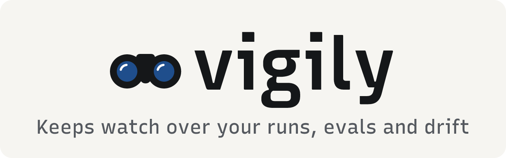
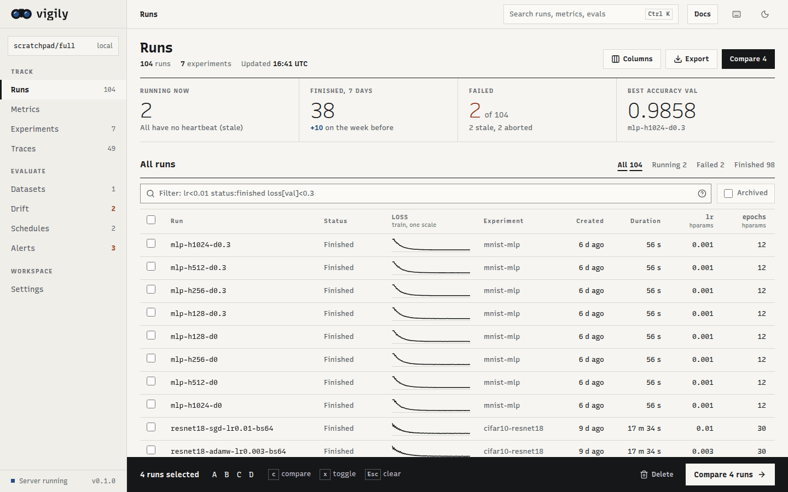
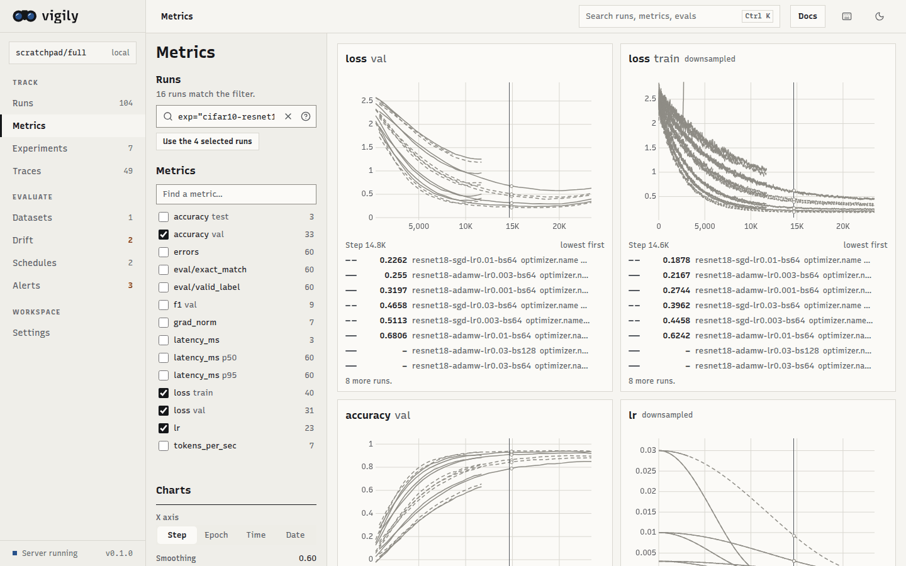
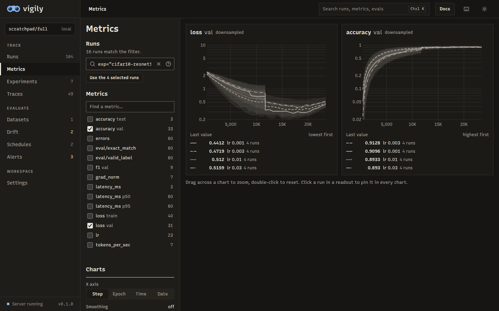
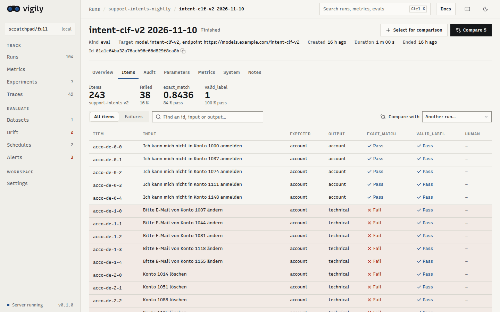
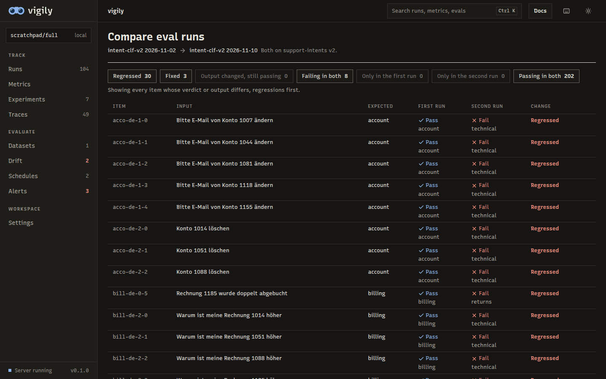
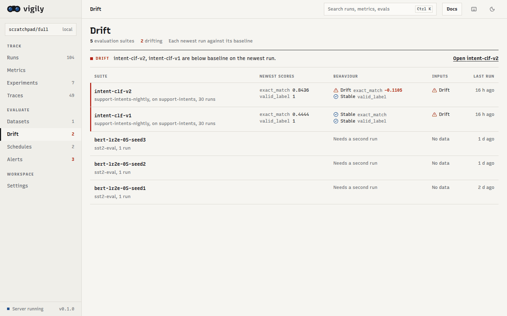
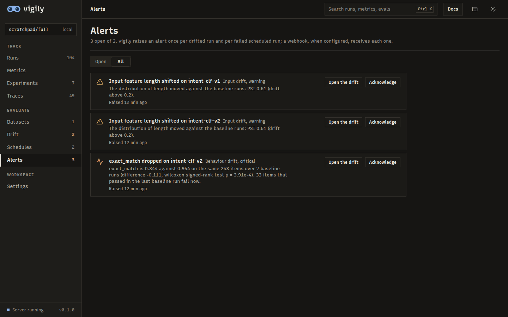
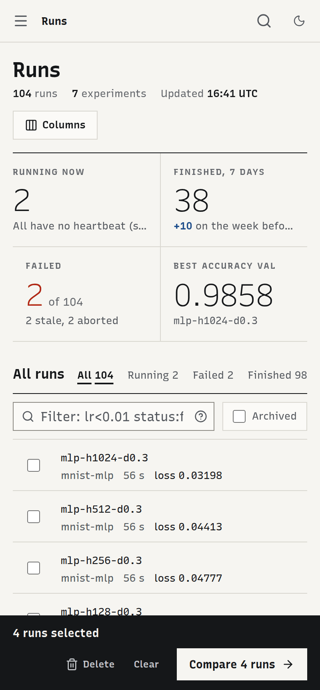
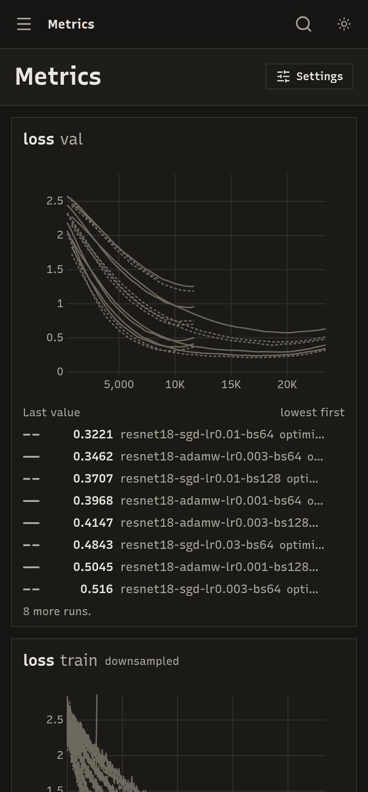

<p align="center">
  <picture>
    <source media="(prefers-color-scheme: dark)" srcset="assets/banner-dark.png">
    
  </picture>
</p>

<p align="center">
  <b>An experiment tracker that keeps watch.</b><br>
  Training runs, evaluations, scheduled evals and drift detection in one self-hosted engine.
</p>

<p align="center">
  <a href="https://vigily.pages.dev/">Docs</a> ·
  <a href="https://vigily.pages.dev/getting-started/">Getting started</a> ·
  <a href="https://vigily.pages.dev/concepts/">Concepts</a> ·
  <a href="https://vigily.pages.dev/guides/python-sdk/">Python SDK</a> ·
  <a href="https://vigily.pages.dev/guides/drift/">Drift methods</a> ·
  <a href="CHANGELOG.md">Changelog</a> ·
  <a href="CONTRIBUTING.md">Contributing</a>
</p>

<p align="center">
  <picture>
    <source media="(prefers-color-scheme: dark)" srcset="docs/assets/screenshots/runs-desktop-dark.png">
    
  </picture>
</p>

> vigily is in beta: the API may still change before 0.1.0.

## Why vigily

Most teams stitch together a tracker for training runs (MLflow, W&B), a tool for LLM and model
evaluations (Langfuse) and a monitor for drift (Evidently). vigily is one engine that does the three
jobs together, on storage you already have:

- **One engine, no services.** `vigily-engine` (or `vigily up`) serves the web app, an HTTP API, the
  scheduler and the drift monitor, and is the only process that writes storage. No database
  server, no queue, no Node at runtime; the Python SDK is a 60 kB pure-Python package.
- **Evaluations that keep running.** Versioned, content-addressed datasets; `evaluate()` with built-in
  and custom evaluators; schedules from a config file run them nightly in your time zone.
- **Drift you can trust.** Paired tests on matched items with effect sizes and the items that
  regressed, against a baseline that never absorbs a regression; input drift by PSI and
  Jensen–Shannon divergence. Every verdict shows its evidence.
- **LLM traces with tokens and cost.** `vigily.trace(...)` records nested spans (also over OTLP/HTTP
  JSON), prices model calls from your own price table, and stores prompts truncated, in full or not
  at all, per project.
- **Storage on [kv0](https://github.com/sayef/kv0).** Lance tables in a directory or on S3, GCS or
  Azure; many training jobs can write at once.
- **Fast with many runs and long curves.** Thousands of runs filter and sort in memory; charts never
  ask for more points than they have pixels.

## Quickstart

### Install with pip

Releases publish two packages to PyPI: `vigily`, the Python SDK (pure Python, no dependencies),
and `vigily-engine`, the engine that stores runs and serves the web app, as a platform wheel for
Linux and macOS. `vigily[local]` installs both:

```bash
pip install 'vigily[local]'   # the SDK and the engine for this machine
vigily-engine                 # serves ./.vigily; open the link it prints (Ctrl-C to stop)
python train.py               # in another shell: logs to that engine
```

Without a running engine, the SDK starts one in the background for the repository (`.vigily`, or
`VIGILY_REPO`), which stops after 30 idle minutes. To log to an engine elsewhere, such as a
[team server](docs/guides/team-server.md), install only the SDK and point it there with a token
that has the `read` and `ingest` scopes:

```bash
pip install vigily
VIGILY_URL=https://vigily.example.com VIGILY_TOKEN=vgy_... python train.py
```

Until 0.1.0 every release is a beta; pip installs the newest one when no stable release exists.

### Install the command line

Each GitHub release also carries prebuilt binaries for Linux (x86_64 and arm64, glibc 2.31 or
newer) and macOS (Apple silicon and Intel): `vigily`, the command line, and `vigily-engine`. The
installer picks the right archive, checks its SHA-256 against the release's checksum file and puts
both in `~/.local/bin`, without sudo:

```bash
curl -LsSf https://raw.githubusercontent.com/sayef/vigily/main/scripts/install.sh | sh
```

To read the script before running it, download it first:

```bash
curl -LsSfO https://raw.githubusercontent.com/sayef/vigily/main/scripts/install.sh
sh install.sh
```

`VIGILY_VERSION=v0.1.0-beta.3` installs a given release and `VIGILY_INSTALL_DIR` changes the
directory. Releases are published as pre-releases, which `latest` does not serve: set
`VIGILY_VERSION` (or `VIGILY_IMAGE` for Docker) to a beta tag.

`vigily up` runs the engine in the foreground and prints a link that signs the browser in;
`vigily open` opens the web app of an engine that is already running, `vigily runs` lists runs,
and `vigily tokens create` makes tokens for scripts and people on a shared engine (see the
[command line guide](docs/guides/cli.md)).

### Build from source

Build with Rust, Node 24, [uv](https://docs.astral.sh/uv/) and `protoc`:

```bash
git clone https://github.com/sayef/vigily && cd vigily
(cd crates/vigily-ui && npm ci && npm run build)      # the engine embeds the web app
cargo build --release -p vigily-cli -p vigily-server   # vigily and vigily-engine
uv sync                                               # the Python SDK, editable
export PATH="$PWD/target/release:$PATH"               # the SDK starts vigily-engine from PATH

uv run --no-sync python examples/demo.py              # synthetic training runs
uv run --no-sync python examples/eval_demo.py         # 30 synthetic nights of evaluations
vigily stop && vigily up --config examples/vigily.toml   # open the link it prints
```

### Run with Docker

Each release publishes a multi-platform image (amd64 and arm64) as `ghcr.io/sayef/vigily`, tagged
`vX.Y.Z`, `X.Y` and `latest`. `compose.yaml` runs it and serves the web app on
<http://localhost:7600>, with the repository in a named volume. The container runs in server mode
and needs an admin token, which you also sign in with:

```bash
export VIGILY_ADMIN_TOKEN=$(openssl rand -hex 32)
docker compose up -d
```

`compose.dev.yaml` builds the image from a checkout instead:

```bash
docker compose -f compose.yaml -f compose.dev.yaml up -d --build
```

Scripts log to it over HTTP with a token that has the `read` and `ingest` scopes:

```bash
docker compose exec vigily sh -c \
  'vigily --url http://127.0.0.1:7600 --token "$VIGILY_ADMIN_TOKEN" tokens create train --scope read --scope ingest'
VIGILY_URL=http://localhost:7600 VIGILY_TOKEN=vgy_... python train.py
```

[Getting started](docs/getting-started.md#run-with-docker) has the details, and
[Running a team server](docs/guides/team-server.md) covers tokens, TLS and backups.

Log a run:

```python
from vigily import Run

with Run(experiment="cifar10", name="resnet18-lr3e-3") as run:
    run["hparams"] = {"lr": 3e-3, "batch_size": 128}
    for step, loss in train():
        run.track(loss, name="loss", step=step, context={"subset": "train"})
```

Evaluate a model on a versioned dataset:

```python
from vigily import Dataset, evaluate, evaluators as ev

evaluate(
    Dataset("support-intents"),
    target=classify,
    evaluators=[ev.exact_match(), ev.custom("judge", my_judge)],
    target_ref={"model": "intent-clf-v2"},
    experiment="support-intents-nightly",
)
```

## Screenshots

<table>
  <tr>
    <td></td>
    <td></td>
  </tr>
  <tr>
    <td></td>
    <td></td>
  </tr>
  <tr>
    <td></td>
    <td></td>
  </tr>
</table>

<p align="center">
  
  
</p>

## Documentation

The documentation is a mkdocs-material site in [`docs/`](docs); build it with
`uvx --with mkdocs-material mkdocs serve`.

- [Getting started](docs/getting-started.md) and [concepts](docs/concepts.md)
- Guides: [Python SDK](docs/guides/python-sdk.md), [command line](docs/guides/cli.md),
  [configuration](docs/guides/configuration.md), [scheduled evaluations and security](docs/guides/scheduled-evals.md),
  [drift methods](docs/guides/drift.md), [LLM tracing](docs/guides/tracing.md), [self-hosting and storage](docs/guides/storage.md),
  [the audit trail](docs/guides/audit-trail.md)
- Design: [brand](brand/DESIGN.md), [architecture](docs/architecture.md), [decisions](DESIGN.md)
- [FAQ](docs/faq.md)

## Status

vigily is new (0.1, unreleased). It runs end to end on the demo and on 2 000 synthetic runs with 4.8
million points (start-up 0.2 s, every request in about 0.1 s or less). [TODO.md](TODO.md) lists what comes next,
and [docs/kv0-requests.md](docs/kv0-requests.md) what it needs from its storage layer.

Drift verdicts and evaluation scores are evidence for people to review, not automated decisions.

## Licence

MIT. See [LICENSE](LICENSE).
